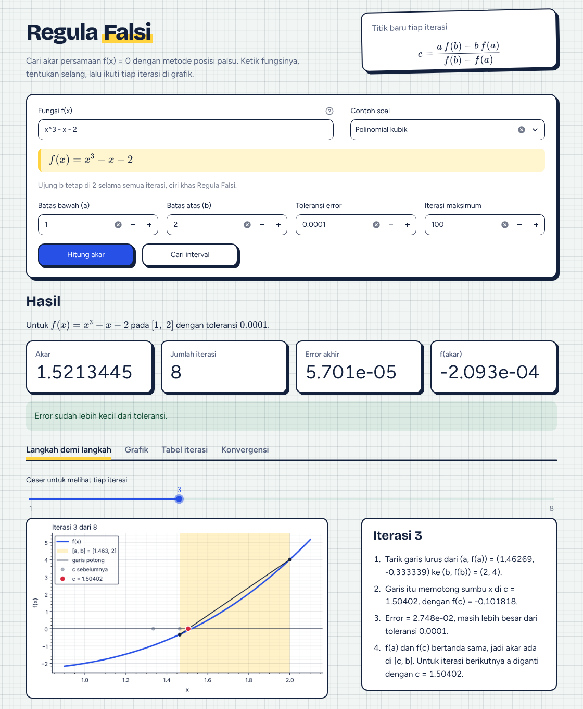
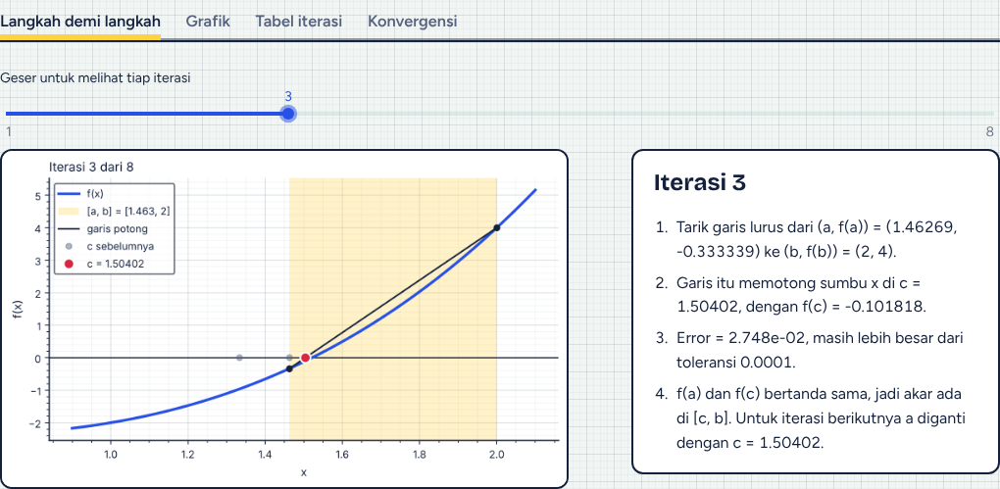
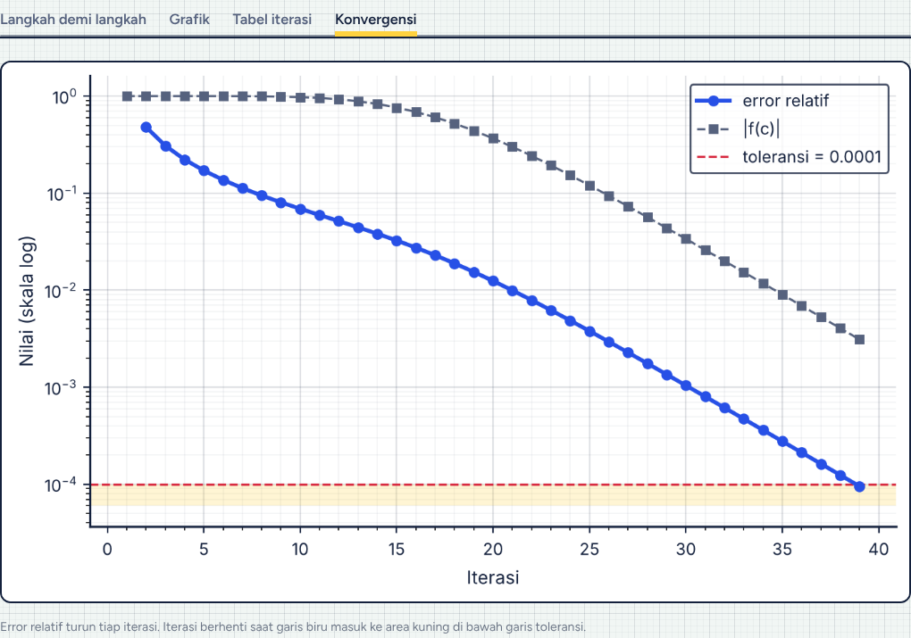
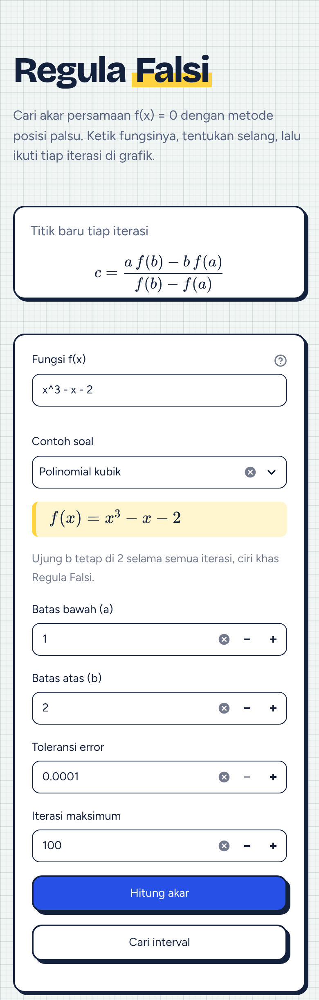
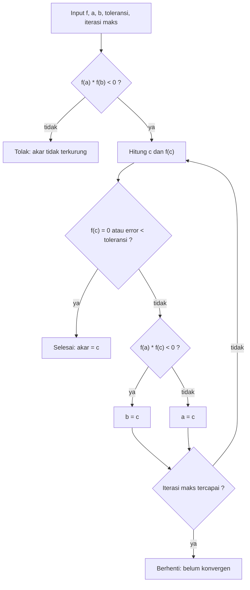
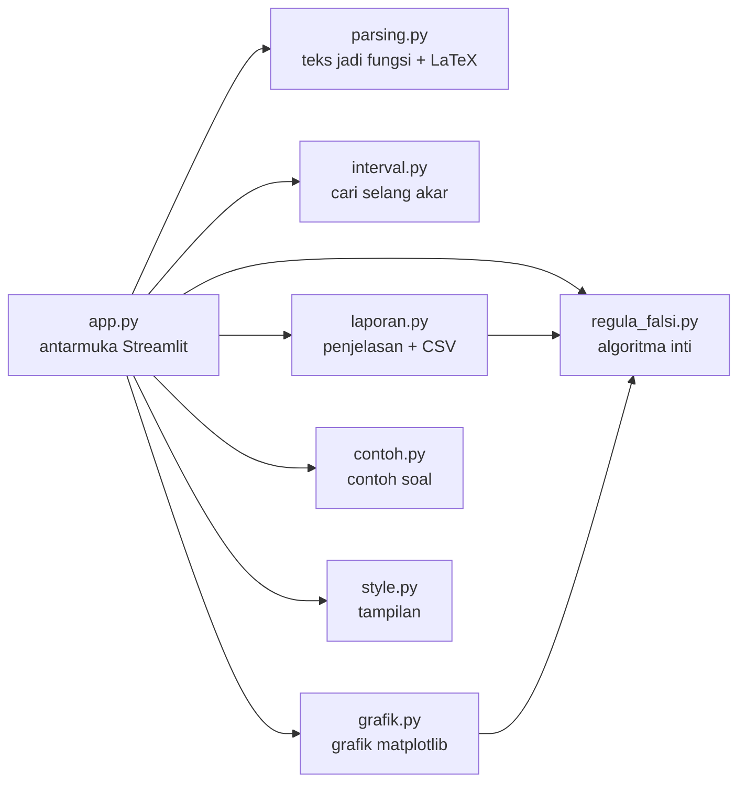

# Regula Falsi Visualizer

[](https://github.com/K2Sandy/Regula-Falsi-Visualizer/actions/workflows/ci.yml)


Kalkulator persamaan nonlinier berbasis web yang mencari akar `f(x) = 0` dengan
**Metode Regula Falsi** (posisi palsu). Bukan cuma menampilkan angka akhir:
setiap iterasi bisa ditelusuri lewat grafik garis potong dan penjelasan dalam
kalimat, sehingga cara kerja metodenya ikut terlihat.

Dibuat oleh Kelompok 3 untuk Praktikum Komputasi Numerik C.



## Daftar isi

- [Fitur](#fitur)
- [Tangkapan layar](#tangkapan-layar)
- [Cara menjalankan](#cara-menjalankan)
- [Cara memakai](#cara-memakai)
- [Contoh soal](#contoh-soal)
- [Metode Regula Falsi](#metode-regula-falsi)
- [Arsitektur](#arsitektur)
- [Struktur proyek](#struktur-proyek)
- [Pengujian](#pengujian)
- [Tim](#tim)
- [Lisensi](#lisensi)

## Fitur

| Fitur | Keterangan |
|-------|------------|
| Input fungsi bebas | Ketik seperti di buku: `x^3 - x - 2`, `2x + 1`, `cos(x) = x`, `e^x = 3`. Simbol salin-tempel (`−`, `×`, `²`, `π`, `√`) otomatis dikenali. |
| Pratinjau rumus | Teks yang diketik langsung ditampilkan sebagai rumus matematika, jadi salah ketik terlihat sebelum menghitung. |
| Contoh soal | Enam soal siap pakai, termasuk kasus lambat `x^10 - 1` yang menunjukkan kelemahan metode ini. |
| Cari interval | Mencari selang `[a, b]` yang mengurung akar di rentang -10 sampai 10, lengkap dengan pengecekan kutub (misal `1/x`). |
| Langkah demi langkah | Slider untuk menelusuri tiap iterasi: garis potong, titik `c`, jejak `c` sebelumnya, dan penjelasan dalam kalimat. |
| Grafik konvergensi | Error relatif dan `\|f(c)\|` per iterasi dalam skala log, dengan garis toleransi. |
| Tabel iterasi | Kolom `a`, `b`, `c`, `f(a)`, `f(b)`, `f(c)`, dan error, bisa diunduh sebagai CSV. |
| Validasi input | Pesan error yang jelas untuk interval terbalik, `f(a)` dan `f(b)` bertanda sama, fungsi tak terdefinisi, atau nama yang tidak dikenal. |
| Aman | Teks fungsi diperiksa dengan daftar putih sebelum dibaca sympy, jadi tidak bisa dipakai untuk menjalankan kode. |
| Ramah HP | Tata letak menyesuaikan layar kecil. |

## Tangkapan layar

**Langkah demi langkah.** Iterasi 3 dari `x^3 - x - 2`: garis lurus dari
`(a, f(a))` ke `(b, f(b))` memotong sumbu x di `c`, dan titik abu-abu adalah
`c` dari iterasi sebelumnya.



**Konvergensi.** Kasus lambat `x^10 - 1` butuh 39 iterasi. Garis `|f(c)|` masih
di atas toleransi saat iterasi berhenti, bukti bahwa error relatif bukan jarak
ke akar sebenarnya (penjelasan lengkap di [docs/algoritma.md](docs/algoritma.md)).



<table>
  <tr>
    <td width="300"></td>
    <td><b>Di layar HP.</b> Kolom input tersusun ke bawah, angka hasil menjadi
    kisi 2 × 2, dan tab bisa digeser ke samping.</td>
  </tr>
</table>

## Cara menjalankan

Butuh Python 3.11 atau lebih baru.

```bash
git clone https://github.com/K2Sandy/Regula-Falsi-Visualizer.git
cd Regula-Falsi-Visualizer

python -m venv .venv
source .venv/bin/activate        # Windows: .venv\Scripts\activate
pip install -r requirements.txt

streamlit run app.py
```

Aplikasi terbuka di `http://localhost:8501`.

## Cara memakai

1. Ketik fungsi di kolom **Fungsi f(x)**, atau pilih salah satu **Contoh soal**.
2. Isi **Batas bawah (a)** dan **Batas atas (b)**. Kalau belum tahu selangnya,
   tekan **Cari interval**.
3. Isi **Toleransi error** (misal `0.0001`) dan **Iterasi maksimum** (misal `100`).
4. Tekan **Hitung akar**.
5. Buka tab **Langkah demi langkah** dan geser slider untuk melihat tiap iterasi.

Penulisan fungsi yang diterima:

| Ditulis | Dibaca sebagai |
|---------|----------------|
| `x^3`, `x**3` | x pangkat 3 |
| `2x`, `2(x + 1)` | `2*x`, `2*(x + 1)` |
| `e^x`, `exp(x)` | eksponensial |
| `ln(x)`, `log(x)` | logaritma natural |
| `log10(x)`, `log2(x)` | logaritma basis 10 dan 2 |
| `sqrt(x)`, `cbrt(x)`, `abs(x)` | akar kuadrat, akar pangkat tiga, nilai mutlak |
| `sin cos tan cot sec csc` dan inversnya | trigonometri (radian) |
| `cos(x) = x` | `cos(x) - x = 0` |

Daftar lengkap ada di [docs/algoritma.md](docs/algoritma.md#format-input-fungsi).

## Contoh soal

Semua dengan toleransi `0.0001` dan iterasi maksimum `100`. Angka ini dicek
otomatis oleh tes.

| Nama | Fungsi | Interval | Akar | Iterasi |
|------|--------|----------|------|---------|
| Polinomial kubik | `x^3 - x - 2` | [1, 2] | 1.521344 | 8 |
| Cosinus sama dengan x | `cos(x) - x` | [0, 1] | 0.739085 | 5 |
| Eksponensial | `e^x - 3` | [0, 2] | 1.098576 | 11 |
| Akar kuadrat dari 2 | `x^2 - 2` | [1, 2] | 1.414201 | 6 |
| Logaritma natural | `ln(x) - 1` | [2, 3] | 2.718296 | 5 |
| Kasus lambat | `x^10 - 1` | [0, 1.3] | 0.999689 | 39 |

## Metode Regula Falsi

Syaratnya `f` kontinu di `[a, b]` dan `f(a) * f(b) < 0`, artinya akar terkurung
di dalam interval. Tiap iterasi menarik garis lurus dari `(a, f(a))` ke
`(b, f(b))` dan memakai titik potongnya dengan sumbu x sebagai tebakan akar:

```
c = (a * f(b) - b * f(a)) / (f(b) - f(a))
```



Error yang dipakai adalah error relatif `|c_baru - c_lama| / |c_baru|`. Kalau
akarnya sangat dekat 0, dipakai error absolut `|c_baru - c_lama|` supaya tidak
membagi dengan nol. Contoh perhitungan lengkap per iterasi, kasus khusus, dan
penjelasan kenapa ujung interval bisa "macet" ada di
[docs/algoritma.md](docs/algoritma.md).

## Arsitektur

Logika hitung dipisah dari tampilan, jadi tiap bagian bisa dites tanpa membuka
aplikasi.



## Struktur proyek

```
app.py                  antarmuka Streamlit
regula_falsi.py         inti algoritma Regula Falsi
parsing.py              mengubah teks f(x) menjadi fungsi Python dan rumus LaTeX
interval.py             mencari selang [a, b] yang mengurung akar
laporan.py              penjelasan tiap iterasi dan ekspor tabel ke CSV
grafik.py               grafik f(x), grafik per iterasi, dan grafik konvergensi
contoh.py               daftar contoh soal
style.py                CSS tambahan (kertas grid, kartu, tab)
.streamlit/config.toml  tema warna dan font
docs/algoritma.md       cara kerja metode dan contoh perhitungan
docs/gambar/            tangkapan layar untuk README
tests/                  tes pytest, termasuk tes antarmuka dengan AppTest
requirements.txt        dependensi aplikasi
requirements-dev.txt    dependensi untuk tes dan lint
pyproject.toml          konfigurasi pytest dan ruff
.github/workflows/      CI: ruff dan pytest di Python 3.11 - 3.13
```

## Pengujian

```bash
pip install -r requirements-dev.txt
ruff check .
pytest
```

Ada lebih dari 200 tes yang mencakup algoritma, validasi input, parsing,
pencarian interval, contoh soal, grafik, dan antarmuka Streamlit (lewat
`streamlit.testing.v1.AppTest`, tanpa membuka browser). GitHub Actions
menjalankan lint dan semua tes di Python 3.11, 3.12, dan 3.13 setiap ada push
ke `main` dan pull request.

## Tim

Kelompok 3, Praktikum Komputasi Numerik C:

- Siti Salwa Shafina
- Al Aul Tsaqif
- Nawal Azqia
- Syella Zikra Arifa
- Keisya Zahira
- Muhammad Albharaka Putrosandy

## Lisensi

Belum ditentukan.
